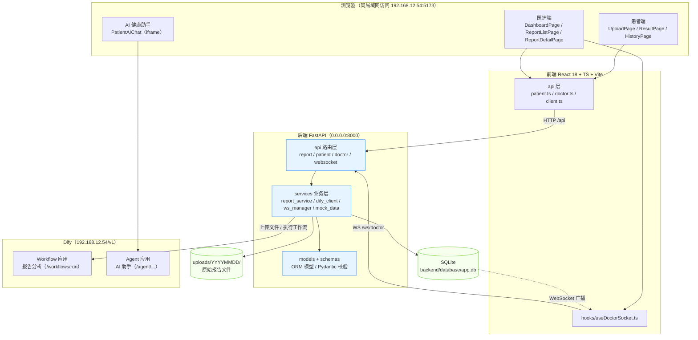
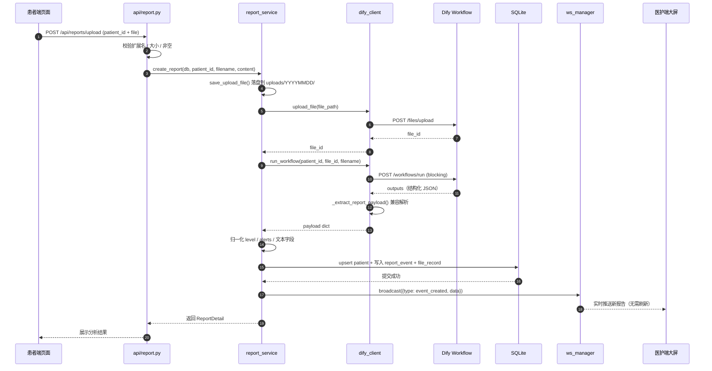
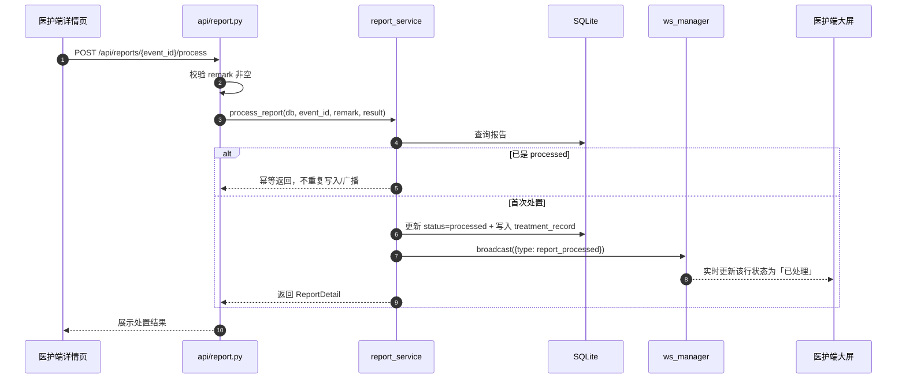
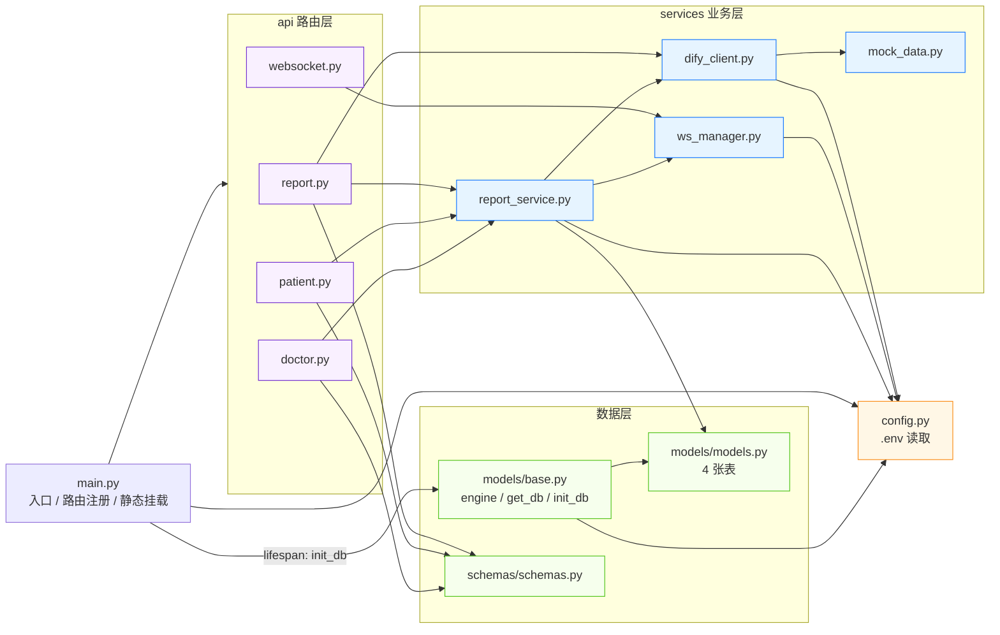
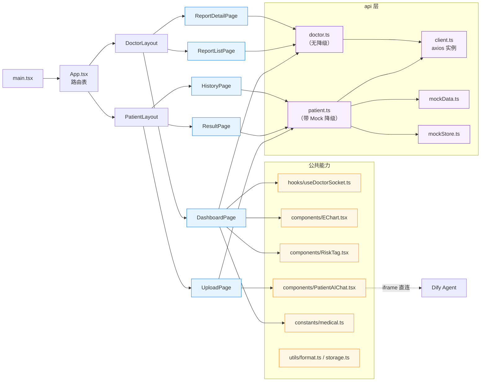
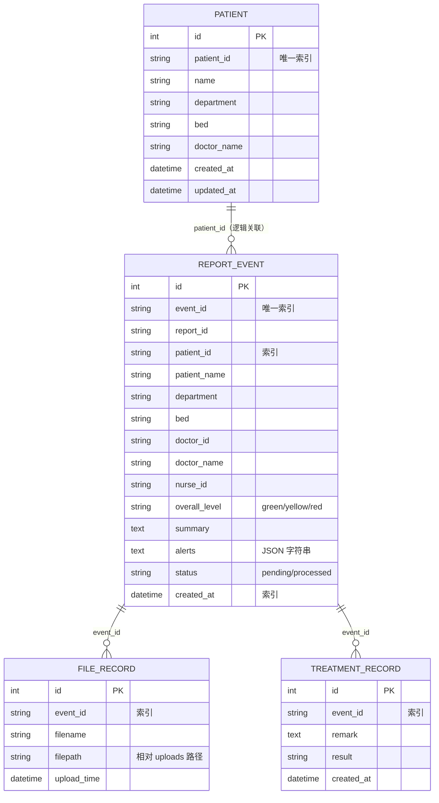
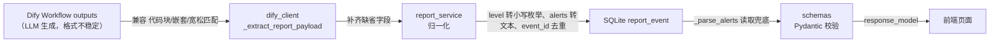
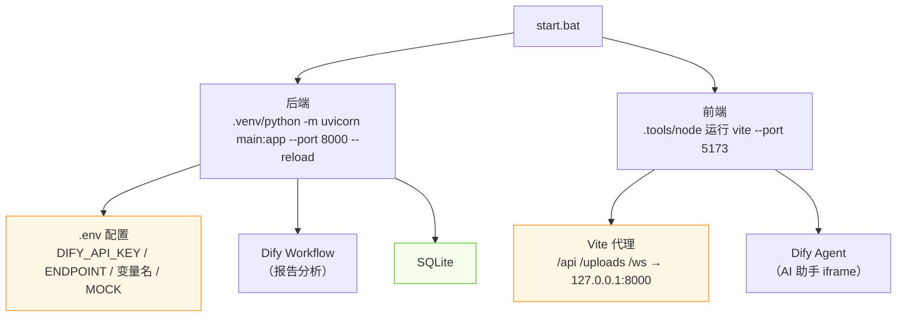

# 医疗检查报告智能分析系统 · 结构示意图

> 本文档用图解释系统「每个环节如何执行、模块之间如何依赖」，与代码一一对应。
> 阅读顺序建议：先看全景图建立整体印象，再看时序图理解数据流，最后看前后端依赖图深入细节。

---

## 一、系统全景架构图

**关键依赖关系（从上到下）**

| 层 | 依赖什么 | 说明 |
| --- | --- | --- |
| 前端页面 | `api/*` + `hooks` | 页面只调接口层，不直接碰 HTTP/WS |
| `api/client.ts` | 后端 `/api` | axios 实例，由 Vite 代理到 `127.0.0.1:8000` |
| `useDoctorSocket.ts` | 后端 `/ws/doctor` | 原生 WebSocket，3s 重连 + 25s 心跳 |
| 后端路由层 | `services` | 路由只做参数校验和异常转换，业务全在 services |
| `report_service` | `dify_client` + `ws_manager` + `models` | 核心编排：落盘 → Dify → 落库 → 广播 |
| `dify_client` | Dify `Workflow` | 上传文件拿 file_id，再执行工作流 |
| `ws_manager` | 无外部依赖 | 进程内连接池单例，仅医护端 |
| `PatientAIChat` | Dify `Agent` | 纯前端 iframe，**不经过后端** |

---

## 二、核心业务流程时序图

### 2.1 患者上传报告 → AI 分析 → 实时推送

> 环节 6 的 `broadcast` 是异步推送，不阻塞接口返回；若当前无医护端在线，仅记录日志跳过（见 [ws_manager.py](backend/services/ws_manager.py)）。

### 2.2 医护处置报告 → 状态同步

---

## 三、后端模块依赖图

**后端模块职责对照表**

| 文件 | 职责 | 依赖 |
| --- | --- | --- |
| [main.py](backend/main.py) | FastAPI 启动、注册 4 个路由、挂载 `/uploads`、lifespan 建表 | api、config、models.base |
| [config.py](backend/config.py) | 从 `.env` 读 Dify 参数、路径、上传限制 | 无 |
| [api/report.py](backend/api/report.py) | 上传/列表/详情/处置 4 个接口 | report_service、dify_client |
| [api/patient.py](backend/api/patient.py) | 患者信息、历史报告查询 | report_service |
| [api/doctor.py](backend/api/doctor.py) | 大屏统计、实时报警列表 | report_service |
| [api/websocket.py](backend/api/websocket.py) | `/ws/doctor` 连接与心跳 | ws_manager |
| [services/report_service.py](backend/services/report_service.py) | **核心**：落盘→Dify→归一化→落库→广播，以及查询/处置/统计 | dify_client、ws_manager、models |
| [services/dify_client.py](backend/services/dify_client.py) | Dify 文件上传 + 工作流调用 + 结果解析 | config、mock_data |
| [services/ws_manager.py](backend/services/ws_manager.py) | 进程内连接池，`broadcast` 广播 | config |
| [services/mock_data.py](backend/services/mock_data.py) | `DIFY_MOCK=true` 时的本地假数据 | config |
| [models/base.py](backend/models/base.py) | SQLAlchemy engine、会话、建表 | config |
| [models/models.py](backend/models/models.py) | patient / report_event / treatment_record / file_record | models.base |
| [schemas/schemas.py](backend/schemas/schemas.py) | Pydantic 请求/响应模型（`response_model` 校验） | 无 |

---

## 四、前端模块依赖图

**前端关键差异（务必注意）**

| 端 | api 层 | Mock 降级 | 原因 |
| --- | --- | --- | --- |
| 患者端 | [patient.ts](frontend/src/api/patient.ts) | **有**（后端不可用/5xx 时降级本地数据） | 保证患者端演示不中断 |
| 医护端 | [doctor.ts](frontend/src/api/doctor.ts) | **无**（失败如实报错） | 大屏与 WebSocket 依赖后端实时数据，无法用本地数据替代 |

**路由映射**

| 路径 | 页面 | 数据来源 |
| --- | --- | --- |
| `/patient/upload` | UploadPage | `uploadReport()` + `PatientAIChat`（iframe） |
| `/patient/result/:event_id` | ResultPage | `fetchReportDetail()` |
| `/patient/history/:patient_id` | HistoryPage | `fetchPatientReports()` |
| `/doctor/dashboard` | DashboardPage | `fetchDoctorStats()` + `fetchLatestAlerts()` + `useDoctorSocket` |
| `/doctor/reports` | ReportListPage | `fetchDoctorReports()` |
| `/doctor/report/:event_id` | ReportDetailPage | `fetchReportDetail()` + `submitProcess()` |

---

## 五、数据模型关系图（ER）

> 说明：SQLite 模型**未声明物理外键**，关联关系靠 `event_id` / `patient_id` 字符串 + 索引维护（见 [models.py](backend/models/models.py)），保证写入顺序灵活、避免外键约束导致的失败。

---

## 六、系统字段流转（一条数据如何从 AI 走到前端）

三个防错关键点（对应历史踩坑）：

1. **字段归一化**：`_to_text()` 把 Dify 可能返回的数组/对象转文本，防止 Pydantic 校验失败（500）。
2. **event_id 去重**：Dify 可能重复返回同一 event_id，撞库时退回后端生成的 `EVT...`。
3. **created_at 后置**：时间戳由后端 `datetime.now()` 生成，杜绝 AI 幻觉日期破坏排序和统计。

---

## 七、WebSocket 消息协议

| 方向 | type | 触发时机 | 负载 |
| --- | --- | --- | --- |
| 服务端 → 客户端 | `connected` | 连接建立 | `{connections: N}` |
| 服务端 → 客户端 | `event_created` | 新报告落库后 | 完整 ReportDetail |
| 服务端 → 客户端 | `report_processed` | 医护处置后 | `{event_id, status}` |
| 服务端 → 客户端 | `pong` | 响应心跳 | - |
| 客户端 → 服务端 | `ping` | 每 25s 心跳 | - |

---

## 八、运行依赖总览

**启动顺序**：`start.bat` 同时拉起前后端（各自一个窗口，端口占用则自动跳过）。
**停止方式**：`stop.bat` 按「窗口标题 → 命令行 → 端口」三重清理。

> 完整的环境配置与接口清单见 [README.md](README.md)；逐文件级技术细节见 [PROJECT_TECHNICAL_DOCUMENT.md](PROJECT_TECHNICAL_DOCUMENT.md)。
