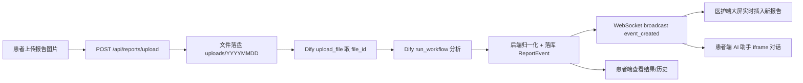
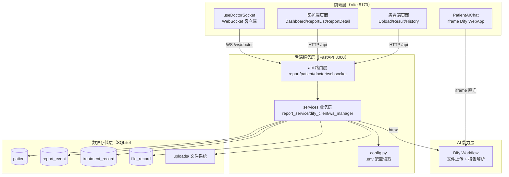
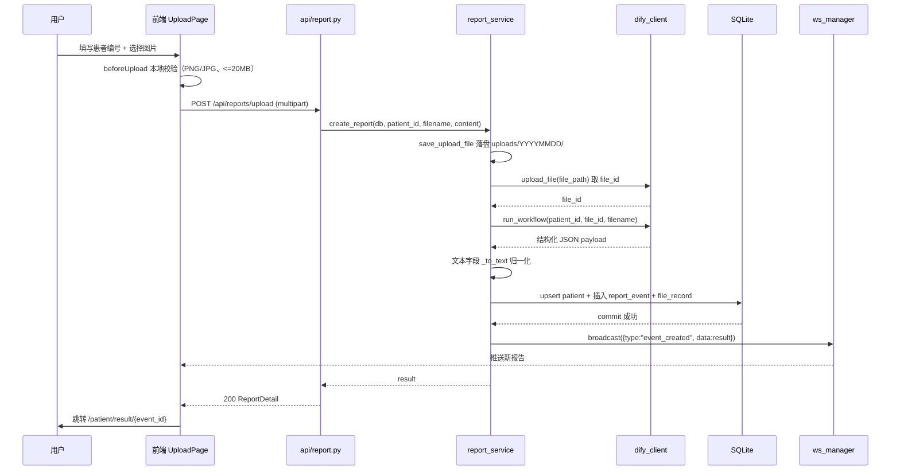
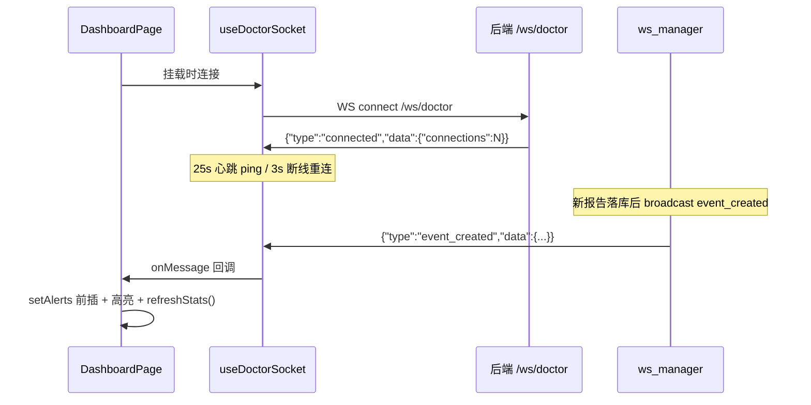

# 医疗检查报告智能分析系统 · 技术交接文档

> 面向未参与开发的技术人员，阅读本文后即可理解系统全貌、模块协作方式与运行验证步骤。
> 所有描述均对应仓库内真实代码，不包含未实现的能力。

---

## 1. 项目概述

### 1.1 项目是什么

一个面向「患者上传检查报告 → AI 自动分析 → 医护实时处置」闭环的 MVP 演示系统。患者端通过 Web 页面上传检查报告图片，后端调用 Dify Workflow 完成 AI 解析，将结构化结果落库，并通过 WebSocket 实时推送到医护端监控大屏；医护端可查看报告详情并提交处置，患者端可回看结果与历史记录，并可与嵌入的 AI 健康助手对话。

### 1.2 解决什么问题

- 传统检查报告（血常规等）依赖人工逐项判读，耗时长、易遗漏异常指标。
- 患者上传报告后缺乏即时反馈，医护端无法第一时间感知新报告与高危情况。
- 需要一个低成本、可演示的端到端方案，验证「AI 报告分析 + 实时推送」的产品闭环。

### 1.3 技术路线

| 层 | 技术选型 |
|---|---|
| 前端 | React 18 + TypeScript + Vite 5 + Ant Design 5 + ECharts 5（按需引入） |
| 后端 | FastAPI + Uvicorn + SQLAlchemy 2 + SQLite |
| AI 能力 | Dify Workflow（文件上传 + 工作流运行，`response_mode=blocking`） |
| 实时通信 | 原生 WebSocket（进程内连接池，无 Redis） |
| 前端 AI 助手 | Dify WebApp 通过 iframe 嵌入（无后端代理） |

### 1.4 核心数据流



---

## 2. 系统总体架构



### 2.1 前端层

- 技术：React 18 + TypeScript + Vite（开发服务器 `host=0.0.0.0`）+ Ant Design 5 + ECharts 5。
- 页面职责：
  - 患者端：上传报告、查看单次分析结果、按患者编号查历史报告。
  - 医护端：实时监控大屏（统计卡 + 实时报告流 + 三张图表）、报告管理列表、报告详情与处置。
- 与后端交互方式：
  - REST 走 `/api` 前缀，由 Vite 代理转发到 `http://127.0.0.1:8000`（`client.ts` 中 `baseURL = /api`）。
  - 原始报告文件走 `/uploads` 静态代理。
  - 实时通道走 `/ws`，WebSocket 地址由 `useDoctorSocket.ts` 通过 `window.location.host` 动态拼接。

### 2.2 后端服务层

- `api/` 只做参数校验、路由与 HTTP 异常转换，不写业务逻辑。
- `services/report_service.py` 承载核心业务：文件落盘、编排 Dify 调用、字段归一化、落库、统计聚合、处置更新、实时广播。
- `services/dify_client.py` 封装对 Dify 的网络调用与结果解析，是唯一与 Dify 交互的模块。
- `services/ws_manager.py` 维护进程内医护端连接池，提供 `connect/disconnect/broadcast`。

### 2.3 AI 能力层

- 采用 Dify Workflow，输入为：`patient_id`（文本变量）+ `report_image`（单文件变量，变量名来自 `.env`，无默认值）。
- 输出为结构化 JSON，字段与后端模型对齐：`patient_id / patient_name / overall_level / summary / alerts / status / report_id / event_id / created_at / department / bed / doctor_* / nurse_id / treatments`。
- Prompt 位于 Dify 平台编排内（仓库不持有），后端不假设变量名，未配置时直接报错。

### 2.4 数据存储层

- SQLite 单文件 `backend/database/app.db`，启动时 `Base.metadata.create_all` 自动建表（无迁移工具）。
- 4 张表：`patient`（患者信息）、`report_event`（核心分析事件）、`treatment_record`（处置记录）、`file_record`（上传文件记录）。
- 上传文件落盘到 `uploads/YYYYMMDD/`，数据库只存相对路径。

### 2.5 实时通信层

- WebSocket 端点 `/ws/doctor`，协议：

```json
// 服务端 -> 客户端
{ "type": "connected",        "data": { "connections": 1 } }
{ "type": "event_created",    "data": { "...报告详情..." } }
{ "type": "report_processed", "data": { "event_id": "...", "status": "processed" } }
{ "type": "pong" }

// 客户端 -> 服务端
{ "type": "ping" }
```

- 触发点：`create_report()` 成功后广播 `event_created`；`process_report()` 处置后广播 `report_processed`。

---

## 3. 核心业务流程

### 流程 1：患者上传报告



关键实现：[report_service.py create_report](file:///e:/EVP/backend/services/report_service.py)（`created_at` 由后端 `datetime.now()` 生成，不采纳 Dify 返回值）。

### 流程 2：Dify 智能分析流程

- 输入字段：`patient_id`（文本）、`report_image`（单文件，`transfer_method=local_file`，携带上一步 `file_id`）。
- 处理：Dify 平台内的 Workflow 对图片做 OCR 与指标分析，`response_mode=blocking` 同步返回。
- 输出 JSON 结构（`data.outputs`）与后端模型一致。
- 后端解析（`dify_client._extract_report_payload`）：
  1. `outputs` 本身含 `patient_id` 且含 `overall_level/alerts` → 直接采用。
  2. 逐字段尝试：字符串则解析 JSON（支持剥离 markdown 代码块）、字典则递归、列表取首元素。
  3. 严格路径未命中时做宽松扫描（DFS 遍历找报告特征字典）。
  4. 命中后用默认字段补齐（`_complete_report_payload`）。
- 状态处理：`succeeded` 与 `partial-succeeded` 均视为可解析；其余状态抛 `DifyError`。

### 流程 3：医护端大屏实时更新



前端监听的事件名为 `event_created` 与 `report_processed`，与后端逐字一致（见 [DashboardPage.tsx](file:///e:/EVP/frontend/src/pages/doctor/DashboardPage.tsx) 的 `handleMessage`）。

### 流程 4：患者 AI 助手

- 接入方式：iframe 直连 Dify WebApp，不经后端代理、不落库、不保存聊天记录。
- URL 来源：优先 `VITE_DIFY_WEBAPP_URL` 环境变量，未配置回退到默认地址。
- 组件：[PatientAIChat.tsx](file:///e:/EVP/frontend/src/components/PatientAIChat.tsx)，嵌入于上传页底部。
- 上下文：当前为无状态独立会话，不注入患者/报告上下文；未来可扩展为在 URL 上携带 `patient_id` 或接入后端会话管理。

---

## 4. 文件级说明

### backend/

#### main.py

后端入口。创建 FastAPI 应用、注册 CORS、挂载路由（`/api` 前缀 + `/ws/doctor`）、挂载 `/uploads` 静态目录；`lifespan` 中调用 `config.ensure_dirs()` 与 `init_db()` 完成目录与建表初始化，并打印 Dify 模式/变量名等启动日志。

#### config.py

统一配置读取，通过 `python-dotenv` 加载 `backend/.env`。暴露 Dify 相关（API Key、Endpoint、输入变量名、Mock 开关与场景）、存储相关（`UPLOAD_DIR`/`DATABASE_URL`）、上传限制（允许扩展名、大小上限）等常量。所有 Dify 输入变量名无默认值，避免臆测。

#### api/report.py

报告接口路由。`POST /reports/upload` 校验 `patient_id` 与文件后调用 `report_service.create_report`，捕获 `DifyError` 转 502；`GET /reports` 分页列表；`GET /reports/{event_id}` 详情；`POST /reports/{event_id}/process` 处置（校验 remark 非空）。

#### api/patient.py

患者接口路由。`GET /patients/{patient_id}` 查询患者信息（不存在返回 404）；`GET /patients/{patient_id}/reports` 转调 `list_reports`。

#### api/doctor.py

医护端查询路由。`GET /doctor/stats` 返回统计卡与图表数据；`GET /doctor/alerts/latest` 返回大屏初始报警列表（`limit` 1~100，默认 20）。

#### api/websocket.py

WebSocket 端点 `/ws/doctor`。连接后发送 `connected`，循环接收客户端消息，对 `ping` 回 `pong`，断开或异常时在 `finally` 中 `manager.disconnect` 清理连接。

#### services/report_service.py

核心业务模块。关键函数：

- `create_report()`：上传主流程（落盘 → Dify → 归一化 → 落库 → 广播）。
- `save_upload_file()`：按日期目录 + UUID 落盘。
- `list_reports()` / `get_patient()` / `get_latest_alerts()`：查询。
- `process_report()`：处置（幂等，已处置不重复写）。
- `get_stats()`：大屏统计（今日/异常/高风险/待处理 + 分布/科室/趋势）。
- 归一化工具：`_normalize_level`（非法等级回落 green）、`_to_text`（复合值转文本）、`_normalize_alert` / `_normalize_alerts`（告警字段别名映射）。

#### services/dify_client.py

Dify 调用封装。`upload_file()` 上传文件取 `file_id`；`run_workflow()` 组装输入并调用 `/workflows/run`，解析 `data.outputs`；`_extract_report_payload()` 多层解析 + 宽松回填；异常统一抛 `DifyError`。

#### services/ws_manager.py

进程内连接池。`ConnectionManager` 用 `asyncio.Lock` 保护 `_connections` 列表；`broadcast()` 遍历发送并自动剔除失效连接，空池时记 warning 日志并跳过。模块级单例 `manager` 供 `websocket.py` 与 `report_service.py` 共用。

#### services/mock_data.py

`DIFY_MOCK=true` 时的模拟数据，产出与 Workflow 一致的 JSON。支持 `green/yellow/red/auto` 场景，`auto` 按 `patient_id` 末位字符决定等级。

#### models/base.py

定义 `engine`（SQLite 关闭线程校验）、`SessionLocal`、`Base`、`get_db()`（FastAPI 依赖，每请求一会话）、`init_db()`（导入模型并 `create_all`）。

#### models/models.py

4 张表的 ORM 模型：`Patient`、`ReportEvent`（核心，`alerts` 以 JSON 字符串存 Text）、`TreatmentRecord`、`FileRecord`。

#### schemas/schemas.py

Pydantic 模型：`ReportItem/ReportDetail/ReportListResponse/PatientResponse/AlertListItem/StatsResponse/ProcessRequest` 等，用于响应校验与 Swagger 文档。

### frontend/

#### src/main.tsx

React 入口：`ConfigProvider`（中文 locale + 主题 token）、`AntdApp`（message 上下文）、`BrowserRouter`，`StrictMode` 包裹。

#### src/App.tsx

路由表。患者端（`PatientLayout` 下）：`/patient/upload`、`/patient/result/:event_id`、`/patient/history/:patient_id`；医护端（`DoctorLayout` 下）：`/doctor/dashboard`、`/doctor/reports`、`/doctor/report/:event_id`；`*` 404。

#### src/api/client.ts

统一 axios 实例，`baseURL = /api`，超时 180s（匹配 Dify 同步分析耗时）。响应拦截器统一错误归一化，`shouldFallbackToMock` 判断是否降级（仅无响应或 5xx 降级，4xx 如实报错）。

#### src/api/patient.ts

患者端接口层：`uploadReport`、`fetchReportDetail`、`fetchPatientReports`、`fetchPatientInfo`，失败时按规则降级到本地 Mock 并标记 `source`/`notice`。

#### src/api/doctor.ts

医护端接口层：`fetchDoctorStats`、`fetchLatestAlerts`、`fetchDoctorReports`、`fetchReportDetail`、`submitProcess`。医护端不做 Mock 降级（实时数据无法本地替代）。

#### src/api/mockData.ts / mockStore.ts

本地 Mock 数据生成与 localStorage 存储，规则与后端 `mock_data.py` 一致，用于后端不可用时兜底。

#### src/hooks/useDoctorSocket.ts

WebSocket 客户端 hook。连接 `/ws/doctor`，25s 心跳、3s 断线重连、`onMessage` 通过 ref 避免重建连接。

#### src/components/PatientLayout.tsx / DoctorLayout.tsx

患者端（顶栏 + 横向菜单）与医护端（侧边菜单 + 顶栏）布局，通过 `<Outlet />` 渲染子页面。

#### src/components/PatientAIChat.tsx

AI 健康助手组件，iframe 嵌入 Dify WebApp，`allow="microphone;clipboard-write"`，底部附「不保存对话」说明。

#### src/components/EChart.tsx

ECharts 轻量封装：按需注册、`ResizeObserver` 自适应尺寸、配置变化时 `setOption(option, true)` 全量重设。

#### src/components/RiskTag.tsx / AlertCard.tsx

风险等级标签与异常提醒卡片，供患者端与医护端复用。

#### src/pages/patient/UploadPage.tsx / ResultPage.tsx / HistoryPage.tsx

上传页（患者编号 + 拖拽上传 + 分析流程 + AI 助手）、结果页（等级总览 + 患者/报告信息 + 摘要 + 告警列表）、历史页（按编号查询分页列表）。

#### src/pages/doctor/DashboardPage.tsx / ReportListPage.tsx / ReportDetailPage.tsx

大屏（统计卡 + 实时报告流 + 三图）、报告管理（筛选 + 分页表格）、报告详情（信息 + 原始报告 + 处置 + JSON 查看）。

#### src/constants/medical.ts / utils/format.ts / utils/storage.ts

等级/状态/分析阶段/文件限制常量；时间格式化与 alert 字段映射；localStorage 记住最近患者编号。

#### vite.config.ts

`host=0.0.0.0`，代理 `/api`、`/uploads`、`/ws` 到 `http://127.0.0.1:8000`（`/ws` 启用 `ws:true`）。

---

## 5. 数据结构与接口

### 5.1 数据表

| 表 | 关键字段 | 说明 |
|---|---|---|
| `patient` | patient_id(唯一)、name、department、bed、doctor_name | 患者档案，上传时 upsert |
| `report_event` | event_id(唯一)、report_id、patient_id、overall_level、summary、alerts(JSON文本)、status、created_at | 核心分析事件 |
| `treatment_record` | event_id、remark、result、created_at | 医护处置记录 |
| `file_record` | event_id、filename、filepath、upload_time | 上传文件记录 |

关系：`report_event.event_id` 被 `treatment_record` 与 `file_record` 通过 `event_id` 关联（逻辑外键，未建数据库级外键约束）。

### 5.2 API 接口

| 方法 | 路径 | 请求 | 响应 | 用途 |
|---|---|---|---|---|
| POST | `/api/reports/upload` | form-data: patient_id + file | ReportDetail | 上传并分析 |
| GET | `/api/reports` | query: patient_id/level/status/page/page_size | ReportListResponse | 报告列表 |
| GET | `/api/reports/{event_id}` | - | ReportDetail | 报告详情 |
| POST | `/api/reports/{event_id}/process` | {result, remark} | ReportDetail | 医护处置 |
| GET | `/api/patients/{patient_id}` | - | PatientResponse | 患者信息 |
| GET | `/api/patients/{patient_id}/reports` | query: page/page_size | ReportListResponse | 患者历史 |
| GET | `/api/doctor/stats` | - | StatsResponse | 大屏统计 |
| GET | `/api/doctor/alerts/latest` | query: limit | list[AlertListItem] | 大屏初始列表 |
| WS | `/ws/doctor` | ping | connected/event_created/report_processed/pong | 实时通道 |
| GET | `/uploads/{...}` | - | 静态文件 | 原始报告 |

### 5.3 前端组件关系

```
App (路由)
├── PatientLayout
│   ├── UploadPage ── PatientAIChat
│   ├── ResultPage ── RiskTag / AlertCard
│   └── HistoryPage ── RiskTag
└── DoctorLayout
    ├── DashboardPage ── EChart / RiskTag / useDoctorSocket
    ├── ReportListPage ── RiskTag
    └── ReportDetailPage ── RiskTag / AlertCard
```

---

## 6. AI 模型说明

- 选用 Dify：将 Workflow 编排、Prompt、模型接入、文件处理封装在平台侧，后端只做 HTTP 调用与结果解析，降低 AI 能力集成成本。
- Workflow 输入：`patient_id`（文本）+ `report_image`（单文件变量，`local_file` + `upload_file_id`）。
- Workflow 输出：与后端模型字段一致的结构化 JSON。
- Prompt 设计思想：约束 AI 只输出临床结论字段（`overall_level`、`summary`、`alerts`），系统字段（`event_id`、`report_id`、`created_at`）由后端生成，避免 AI 幻觉污染统计与排序。

---

## 7. 运行与部署

### 7.1 环境要求

- Python 3.11+（虚拟环境 `backend/.venv`）
- Node.js（项目内置便携版 `E:\EVP\.tools\node`）
- Dify 服务（云端或自建，需配置 API Key 与 Workflow 变量名）

### 7.2 后端启动

```powershell
cd e:\EVP\backend
python -m venv .venv
.\.venv\Scripts\python.exe -m pip install -r requirements.txt
Copy-Item .env.example .env   # 填入 DIFY_API_KEY、变量名等
.\.venv\Scripts\python.exe -m uvicorn main:app --reload --host 0.0.0.0 --port 8000
```

### 7.3 前端启动

```powershell
cd e:\EVP\frontend
$env:PATH = "E:\EVP\.tools\node;" + $env:PATH
npm install --registry=https://registry.npmmirror.com
npm run dev   # 监听 0.0.0.0:5173
```

### 7.4 Dify 配置

在 `backend/.env` 中配置：

```ini
DIFY_API_KEY=app-xxx
DIFY_ENDPOINT=http://127.0.0.1/v1   # 或 https://api.dify.ai/v1
DIFY_INPUT_PATIENT_KEY=patient_id
DIFY_INPUT_FILE_KEY=report_image
DIFY_INPUT_FILE_IS_LIST=false
DIFY_MOCK=false
```

变量名必须与 Dify 编排中实际定义一致，可用 `GET {DIFY_ENDPOINT}/parameters` 核对。`.env` 仅在启动时读取，修改后需重启。

### 7.5 验证方式

1. 打开 `http://<host>:5173/patient/upload`，上传 PNG/JPG，确认跳转结果页且返回 `source=backend`（无「本地演示数据」提示）。
2. 打开医护端大屏 `http://<host>:5173/doctor/dashboard`，上传新报告后应实时出现新记录，统计卡数字同步增长。
3. 医护端详情页提交处置，患者端历史记录状态变为「已处理」。
4. 上传页底部 AI 助手 iframe 正常加载并可对话。

---

## 8. 已实现 / 不足 / 优化方向

### 8.1 已实现

- 患者报告上传、Dify 分析、结果/历史查询。
- 医护端大屏统计 + 实时报告流 + 三张图表。
- 医护处置闭环（状态流转 + 处置记录 + 广播）。
- WebSocket 实时推送（心跳、断线重连、连接池）。
- Mock 降级（后端 DIFY_MOCK + 前端 localStorage 兜底）。
- AI 助手 iframe 嵌入。

### 8.2 存在不足

- 无账号体系与权限控制，患者端与医护端均无身份认证，任何访问者均可查看全部报告。
- 无 Redis / 多进程支持，WebSocket 连接池为进程内单例，多 worker 部署时广播会丢失。
- 无数据库迁移工具，仅 `create_all`，字段变更无法增量演进。
- `report_event.event_id` 在 Dify 返回非空时仍可能采纳 AI 生成值（仅撞库/为空时本地生成），存在 ID 不可控风险。
- AI 助手为无状态 iframe，未注入患者/报告上下文，无法提供个性化分析。
- 前端 Mock 降级与真实数据并存，缺少统一的「离线/在线」状态标识边界。

### 8.3 未来优化

- 接入账号体系，患者绑定身份，数据按权限隔离。
- WebSocket 引入 Redis Pub/Sub 或改用支持跨进程的方案，支撑多实例部署。
- 引入 Alembic 管理数据库迁移。
- `event_id`/`report_id`/`created_at` 全面收归后端生成，杜绝 AI 幻觉污染。
- AI 助手接入上下文管理（患者编号、最近报告摘要），提供连续性对话。
- 完善告警与异常监控（Dify 超时、partial-succeeded 的策略化处理）。
